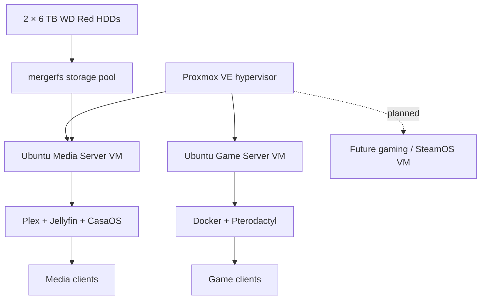

# Homelab Infrastructure

> A hands-on systems administration project covering virtualization, Linux operations, containerized applications, media delivery, game-server hosting, and storage engineering.

**Status:** Active development · **Platform:** Proxmox VE · **Focus:** Reliability, recoverability, and practical infrastructure skills

## Overview

This repository documents a self-hosted homelab designed, deployed, maintained, and troubleshot as an ongoing independent technical project. The environment combines virtual machines, Linux services, containers, dedicated game servers, and a pooled media-storage system.

The goal is not just to run applications—it is to understand how the underlying infrastructure works, document operational decisions, and improve the environment through real troubleshooting.

## Architecture

*Diagram is intentionally simplified and excludes internal IP addresses, credentials, and network entry points.*

## Projects

| Area | Technologies | Work completed |
| --- | --- | --- |
| Virtualization | Proxmox VE, QEMU/KVM, Ubuntu Server | Provisioned and operated multiple VMs; managed virtual disks, resources, and passthrough devices |
| Media services | Docker, Plex, Jellyfin, CasaOS | Deployed containerized streaming services and preserved library paths during a storage migration |
| Storage | mergerfs, ext4, systemd, LVM-thin | Combined two 6 TB drives into one media namespace; configured persistent mounts and dependency-based startup |
| Game hosting | Pterodactyl, Docker, Linux | Hosted and administered dedicated multiplayer game servers |
| Hardware acceleration | NVIDIA GPU passthrough | Configured a dedicated GPU for media-processing workloads |
| Operations | Bash, SSH, rsync, systemd, fstrim | Performed checksum-based migration verification, boot testing, and thin-pool space reclamation |

## Featured project: Live media-storage migration

**Problem:** Large movie and TV libraries occupied space inside an SSD-backed virtual disk, leaving insufficient physical capacity for additional VMs.

**Approach:**
1. Passed two physical 6 TB drives through to the Ubuntu media VM.
2. Formatted and mounted each ext4 filesystem, then combined them with **mergerfs** (approximately 12 TB advertised / 11 TiB usable).
3. Copied the media libraries with `rsync` and performed checksum-based verification.
4. Preserved the Docker-facing paths with bind mounts so existing Plex and Jellyfin libraries continued to work.
5. Added systemd mount dependencies and container-start checks.
6. Confirmed playback and performed a successful normal reboot test.
7. Removed the verified SSD copies and used TRIM to release unused blocks back to Proxmox's LVM-thin storage.

**Outcome:** About **400 GB of media** was migrated to HDD storage, while the media VM's SSD filesystem dropped to approximately **21 GiB used**. The Proxmox media thin pool subsequently reported **3.81% allocated**.

**Trade-off:** mergerfs pools capacity but **does not provide redundancy**. A drive failure can still cause data loss; independent backups remain necessary. Normal reboot behavior has been tested, but physical drive-failure handling has not been fully validated.

## Operational practices

- Verify critical copies with checksums before deleting source data.
- Keep application configuration and transient workloads separate from bulk media.
- Use persistent mount units and service dependencies to control startup order.
- Monitor thin-provisioned storage by **actual physical allocation**, not virtual disk size alone.
- Avoid committing passwords, tokens, private keys, internal addresses, or unreviewed configuration exports to public repositories.

## Repository roadmap

- [x] Document the infrastructure overview
- [x] Document the media-storage migration
- [ ] Add sanitized deployment and recovery guides
- [ ] Add a simplified network diagram and approved screenshots
- [ ] Configure automated **private** configuration backups
- [ ] Document the future SteamOS VM build
- [ ] Document backup-restoration tests

## Skills demonstrated

**Linux administration · Virtualization · Docker · Infrastructure troubleshooting · Filesystem management · Storage migration · systemd · SSH · Hardware passthrough · Technical documentation**

---

**Portfolio note:** This is an independent, practical learning project—not a commercial production deployment. The repository describes implemented work and clearly marks planned improvements.
